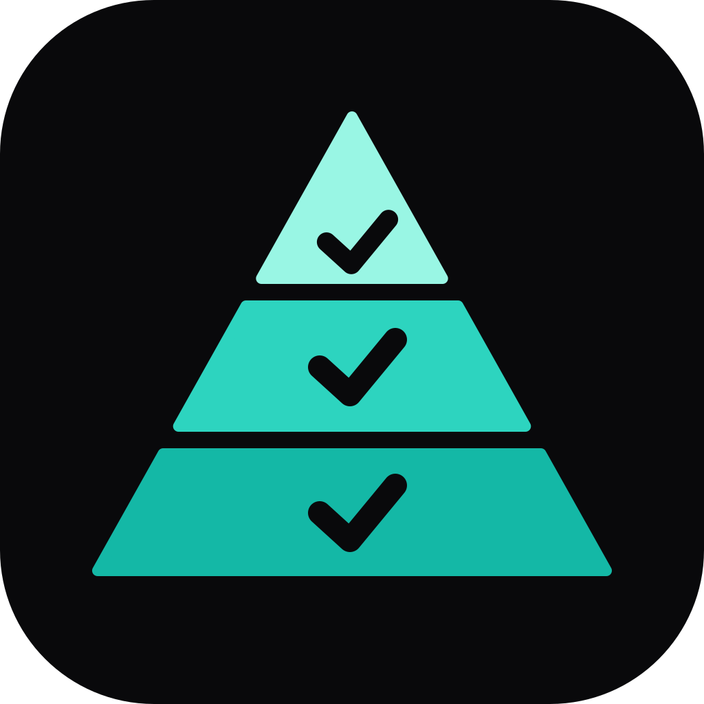

<p align="center"></p>

# QA Automation Skills

Agent skills for building, auditing and evolving test automation in the JavaScript/TypeScript ecosystem. They encode senior-level practice for API, web UI and mobile test suites, and they check official documentation when it matters: when a tool detail is uncertain, version-sensitive or on the skill's "Check first" list (for example a renamed option that old code silently ignores), the skill confirms it against the installed package or the official page for that version and names the page in its reply. Stable, well-known APIs are answered directly, which keeps runs fast.

Compatible with any agent that reads `SKILL.md` files (Claude Code, Codex, Cursor and others via the `skills` CLI).

## Skills

| Skill | Use it when | Covers |
|---|---|---|
| [`qa-automation-orchestrator`](skills/qa-automation-orchestrator/SKILL.md) | Any open-ended testing request: a new framework, a QA take-home, "add tests", "our suite is slow or flaky", a tool choice | Brainstorm one question at a time, a request for the project's own documentation (OpenAPI/Swagger, schemas, architecture, ADRs), reconnaissance, playback, a written test-strategy document, a task-by-task plan, routing to the skills below. Works alongside `superpowers:brainstorming` / `writing-plans` when installed. |
| [`qa-automation-architect`](skills/qa-automation-architect/SKILL.md) | Framework structure, audits of existing suites, tool decisions, CI and reporting | Test pyramid, recon-first design, layering (config, core, clients, schemas, data, fixtures, pages, tests), determinism and flake policy, defects as tests, audit checklist, README template, conventions, Allure + GitHub Pages + sharding, BrowserStack, result aggregation |
| [`qa-unit-tests`](skills/qa-unit-tests/SKILL.md) | Unit and component tests, TDD, mocking, coverage | Vitest, Jest, node:test; React Testing Library (web and React Native); what belongs in a unit test vs higher layers; pure-logic extraction; doubles and msw at the network boundary; fake timers; coverage thresholds, mutation testing (Stryker), property-based tests (fast-check) |
| [`qa-api-tests`](skills/qa-api-tests/SKILL.md) | REST/GraphQL API suites and the client layer under them | Playwright `request`, Jest/Vitest + Axios, Jest + supertest recipes; AJV/OpenAPI/Pact contracts; faker builders; 429-aware retry; baseline-count polling for async side effects; negative-test matrix |
| [`qa-ui-e2e-tests`](skills/qa-ui-e2e-tests/SKILL.md) | Browser end-to-end and UI suites | Locator strategy, thin Page Objects and fixtures, storage-state auth, cross-browser and responsive projects, visual regression, axe accessibility, resilient navigation of volatile A/B-tested funnels, WebdriverIO + BrowserStack |
| [`qa-mobile-tests`](skills/qa-mobile-tests/SKILL.md) | React Native/Expo and native iOS/Android apps | Layering under device tests, Detox, Maestro, Appium + WebdriverIO, BrowserStack App Automate, test hooks, build and CI discipline |

Start with the orchestrator; it decides the size of the work and hands tasks to the other skills.

## Install

With the [`skills`](https://github.com/vercel-labs/skills) CLI. All six skills in one command (project-level, into every supported agent):

```bash
npx skills add sarbash1994/qa-automation-skills --all
```

Variants:

```bash
# all skills, Claude Code only
npx skills add sarbash1994/qa-automation-skills -s '*' -a claude-code -y

# one skill at a time
npx skills add sarbash1994/qa-automation-skills -s qa-automation-orchestrator

# globally, for every project on this machine
npx skills add sarbash1994/qa-automation-skills --all -g

# list what the repository offers without installing
npx skills add sarbash1994/qa-automation-skills -l
```

The CLI records what it installed in `skills-lock.json`; on another machine `npx skills experimental_install` restores it, and `npx skills update` pulls newer versions. Agents pick up new skills on their next session.

As a Claude Code plugin (Claude Code 2.1.275 or later), all six skills in one step:

```
/plugin install qa-automation-skills --marketplace sarbash1994/qa-automation-skills
```

From a shell: `claude plugin install qa-automation-skills --marketplace sarbash1994/qa-automation-skills`. On older versions, add the marketplace first with `/plugin marketplace add sarbash1994/qa-automation-skills`, then run `/plugin install qa-automation-skills@qa-automation-skills`. Plugin skills are namespaced, for example `qa-automation-skills:qa-automation-orchestrator`.

Manual install for Claude Code: copy a `skills/<name>/` directory into `.claude/skills/` of a project (or `~/.claude/skills/` for every project) and start a new session.

## Which skills for which project

The set installs selectively; each skill works on its own and treats references to siblings as optional.

| Situation | Install |
|---|---|
| A product with an existing test suite you want to keep healthy | `qa-unit-tests`, `qa-api-tests`, `qa-ui-e2e-tests`, and `qa-automation-architect` for its audit checklist and review conventions |
| A new framework, a take-home, a strategy or a multi-layer effort | add `qa-automation-orchestrator` |
| A React Native / native mobile app | add `qa-mobile-tests` |
| CI reporting, Allure, BrowserStack, sharding | `qa-automation-architect` |

## How the skills work together

<p align="center">
  
</p>

Every skill has a `references/official-docs.md` with the triggers for a lookup, a "Check first" list of details that drift or fail silently, a lookup protocol (installed version → installed types, documentation MCP or official URL → confirm → name the page in the reply, or mark it unverified) and a map of official documentation pages for the tools it covers. Every reply also lists the files the skill created or changed.

## What the skills change: before and after

The flaky spec that ships in the `shop-web` eval fixture, as a team might inherit it:

```ts
async function login(page) { await page.goto('http://localhost:3000/login'); await page.fill('#email', 'qa@example.com'); /* ... */ await page.waitForTimeout(2000); }
function expectedTotal(items) { let total = 0; for (const i of items) total += i.price * i.qty; return total.toFixed(2); }

test('checkout works', async ({ page }) => {
  await page.click('.product-card:nth-child(1) .add');
  await page.waitForTimeout(1000);
  if (await page.locator('.coupon-banner').isVisible()) { await page.fill('.coupon-input', 'WELCOME10'); /* ... */ }
  try { await page.click('text=Checkout'); } catch (e) { await page.click('.checkout-btn'); }
  await page.waitForTimeout(3000);
  expect(await page.locator('.summary .total').textContent()).toContain(expectedTotal(items));
  await page.click('button >> nth=2');
});
```

The same journey after `qa-ui-e2e-tests` (an actual eval output, trimmed): project fixtures, storage-state auth, API seeding, a thin page object, literal oracles, one behaviour per test, no logic in the spec.

```ts
import { test, expect } from '../../src/fixtures/test-fixtures';

test.describe('Checkout @e2e', () => {
  test.beforeEach(async ({ shopApi }) => { await shopApi.clearCart(); await shopApi.addToCart('SKU-100'); });

  test('WELCOME10 lowers the order total by 10%', async ({ checkoutPage }) => {
    await checkoutPage.open();
    await checkoutPage.applyCoupon('WELCOME10');
    await expect(checkoutPage.total).toHaveText('11.25');
  });

  test('an unknown coupon shows "Coupon not found" and leaves the total unchanged', async ({ checkoutPage }) => {
    await checkoutPage.open();
    await checkoutPage.applyCoupon('NO-SUCH-CODE');
    await expect(checkoutPage.couponError).toHaveText('Coupon not found');
    await expect(checkoutPage.total).toHaveText('12.50');
  });
});
```

Evaluation method and results: [`evals/README.md`](evals/README.md).

## Layout

```
.claude-plugin/
  plugin.json         plugin manifest (lets `claude plugin eval` and `claude plugin validate` run on the repo)
skills/
  <skill-name>/
    SKILL.md          frontmatter (name, description) + instructions
    references/       recipes, templates, checklists, documentation map
evals/
  README.md           method and results
  <skill-name>/
    <case>/           prompt, graders and fixture for one eval case
```

Installing a skill copies only its `SKILL.md` and `references/`; the eval cases stay in the repository.

## Contributing

Keep skills tool-agnostic where the practice is general and point to documentation where it is not: add a URL to the relevant `official-docs.md`, and a "Check first" entry when a detail drifts or fails silently, rather than hard-coding an option value. Keep `SKILL.md` under ~150 lines and move detail into `references/`. No project-specific or personal information. Put eval cases under `evals/<skill>/<case>/`, never inside `skills/`, so they are not installed into users' projects.

## License

MIT. See [LICENSE](LICENSE).
