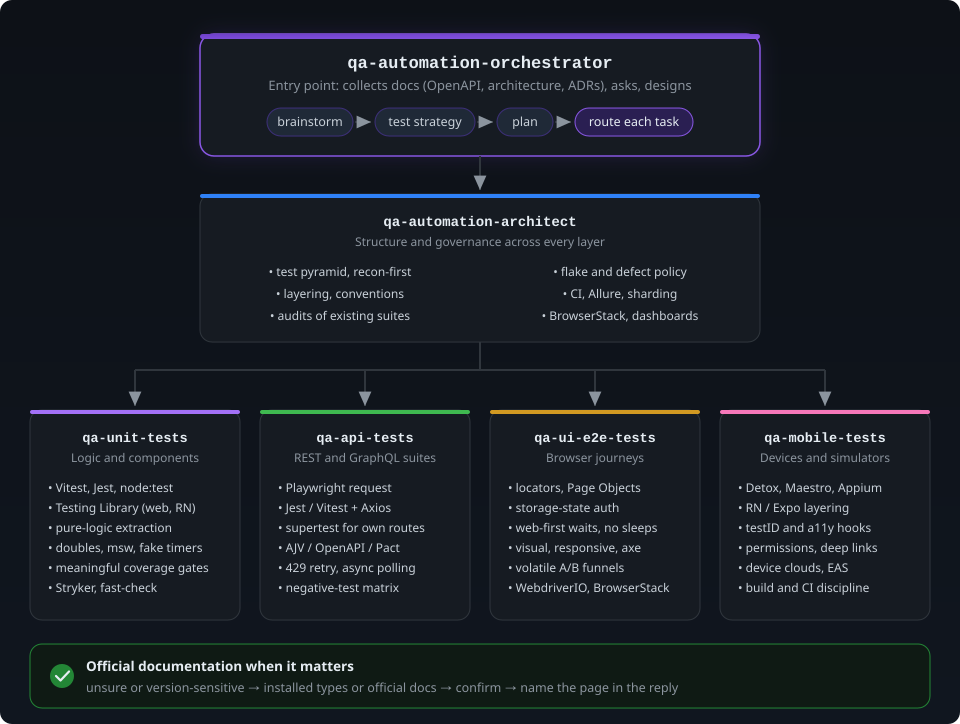

# QA Automation Skills

Agent skills for building, auditing and evolving test automation in the JavaScript/TypeScript ecosystem. They encode senior-level practice for API, web UI and mobile test suites, and they are documentation-first: before producing any tool-specific configuration, command or workflow, a skill reads the official documentation for the version in use and cites it, instead of answering from memory.

Compatible with any agent that reads `SKILL.md` files (Claude Code, Codex, Cursor and others via the `skills` CLI).

## Skills

| Skill | Use it when | Covers |
|---|---|---|
| [`qa-automation-orchestrator`](skills/qa-automation-orchestrator/SKILL.md) | Any open-ended testing request: a new framework, a QA take-home, "add tests", "our suite is slow or flaky", a tool choice | Brainstorm one question at a time, reconnaissance, playback, a written test-strategy document, a task-by-task plan, routing to the skills below. Works alongside `superpowers:brainstorming` / `writing-plans` when installed. |
| [`qa-automation-architect`](skills/qa-automation-architect/SKILL.md) | Framework structure, audits of existing suites, tool decisions, CI and reporting | Test pyramid, recon-first design, layering (config, core, clients, schemas, data, fixtures, pages, tests), determinism and flake policy, defects as tests, audit checklist, README template, conventions, Allure + GitHub Pages + sharding, BrowserStack, result aggregation |
| [`qa-api-tests`](skills/qa-api-tests/SKILL.md) | REST/GraphQL API suites and the client layer under them | Playwright `request`, Jest/Vitest + Axios, Jest + supertest recipes; AJV/OpenAPI/Pact contracts; faker builders; 429-aware retry; baseline-count polling for async side effects; negative-test matrix |
| [`qa-ui-e2e-tests`](skills/qa-ui-e2e-tests/SKILL.md) | Browser end-to-end and UI suites | Locator strategy, thin Page Objects and fixtures, storage-state auth, cross-browser and responsive projects, visual regression, axe accessibility, resilient navigation of volatile A/B-tested funnels, WebdriverIO + BrowserStack |
| [`qa-mobile-tests`](skills/qa-mobile-tests/SKILL.md) | React Native/Expo and native iOS/Android apps | Layering under device tests, Detox, Maestro, Appium + WebdriverIO, BrowserStack App Automate, test hooks, build and CI discipline |

Start with the orchestrator; it decides the size of the work and hands tasks to the other skills.

## Install

With the [`skills`](https://github.com/vercel-labs/skills) CLI (per project; add `-g` for all projects):

```bash
npx skills add sarbash1994/qa-automation-skills -s qa-automation-orchestrator
npx skills add sarbash1994/qa-automation-skills -s qa-automation-architect
npx skills add sarbash1994/qa-automation-skills -s qa-api-tests
npx skills add sarbash1994/qa-automation-skills -s qa-ui-e2e-tests
npx skills add sarbash1994/qa-automation-skills -s qa-mobile-tests
```

List what the repository offers without installing: `npx skills add sarbash1994/qa-automation-skills -l`.

Manual install for Claude Code: copy a `skills/<name>/` directory into `.claude/skills/` of a project (or `~/.claude/skills/` for every project) and start a new session.

## How the skills work together

<p align="center">
  
</p>

Every skill has a `references/official-docs.md` with a lookup protocol (installed version → documentation MCP or official URL → confirm the option → cite it → mark unverified if unreachable) and a map of official documentation pages for the tools it covers.

## Layout

```
skills/
  <skill-name>/
    SKILL.md          frontmatter (name, description) + instructions
    references/       recipes, templates, checklists, documentation map
```

## Contributing

Keep skills tool-agnostic where the practice is general and documentation-first where it is not: add a URL to the relevant `official-docs.md` rather than hard-coding an option value. Keep `SKILL.md` under ~150 lines and move detail into `references/`. No project-specific or personal information.

## License

MIT. See [LICENSE](LICENSE).
